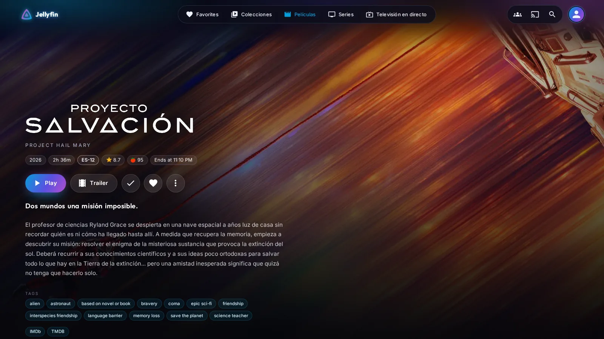
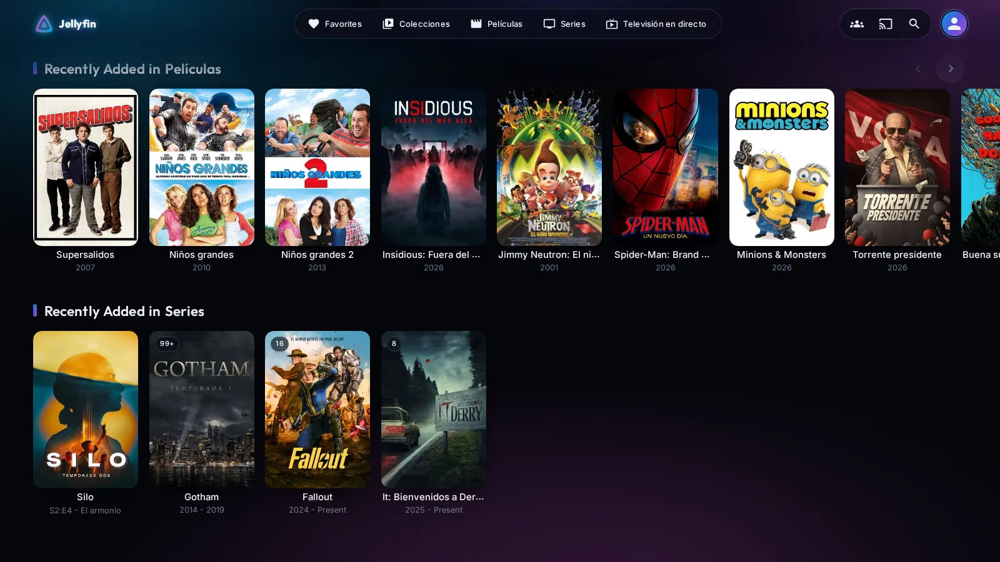
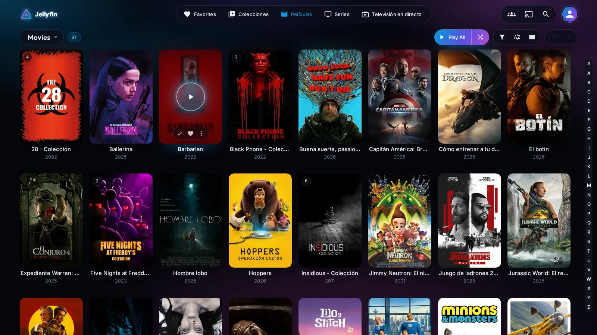
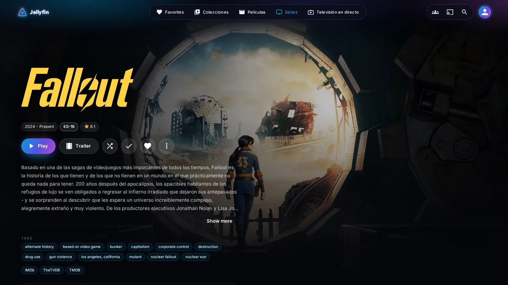
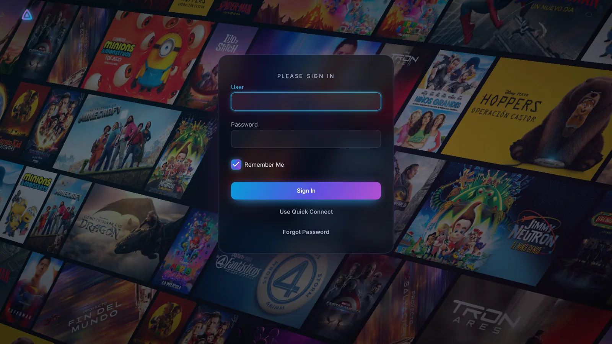
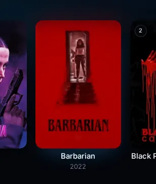
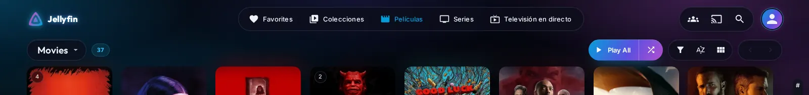
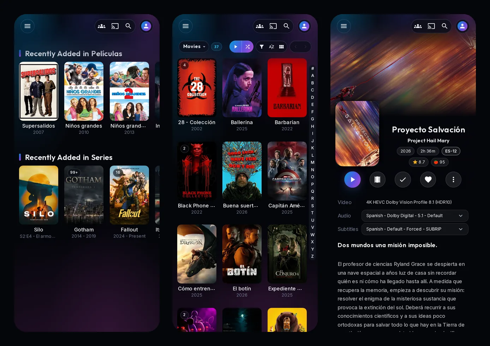

<div align="center">

# NeonFin

**A neon & glass theme for Jellyfin 12**

A near-black background with slow auroras, a frosted-glass top bar that shrinks as you scroll,<br>
cinematic detail pages and calm, slow hover effects. Pure CSS, one line to install.

[](https://jellyfin.org)
[](neonfin.css)
[](LICENSE)
[](https://www.jsdelivr.com/package/gh/CuevasTech/NeonFin)
[](https://github.com/sponsors/CuevasTech)

**[Install](#install)** · **[Customize](#customize)** · **[Screenshots](#screenshots)** · **[Support](#support)**



</div>

## Features

- **Cinematic detail pages.** The backdrop fills the screen with a slow Ken Burns zoom. The logo, info, buttons and tags stack on the left, and the audio, subtitle and credits panels are made of glass. The play button glows in the theme's gradient, with a light sweep and a ripple every few seconds.
- **A glass top bar.** A frosted sheet that fades out softly at the bottom, with no hard edge, and a slow aurora drifting inside. When you scroll, everything shrinks a little.
- **Calm hover effects.** Posters stay in place: a glow lights up underneath, the image zooms slightly inside its frame, and a glass play button pops in. The watched, favourite and more buttons appear centred at the bottom of the poster.
- **Your server as a neon sign.** Your server's name glows in the top bar. You can also use your own logo.
- **A tidier library toolbar.** The title sits with its item count, "Play all" is a gradient pill and the controls are glass capsules. The toolbar shrinks along with the bar.
- **Mobile friendly.** It keeps Jellyfin's mobile layout and restyles it: matching glass buttons in the top bar, the library toolbar on a single line and the detail buttons spread across the screen. It also works in the Android app, including its back button.
- **Light on your GPU.** It mostly animates `transform` and `opacity`, and it cuts animations short when your system asks to reduce motion.
- **Easy to customize.** A few CSS variables control the colours, the logo and the button labels.

## Install

1. In Jellyfin, open **Dashboard → General → Branding → Custom CSS**.
2. Paste this line and save:

   ```css
   @import url("https://cdn.jsdelivr.net/gh/CuevasTech/NeonFin@main/neonfin.css");
   ```

3. Reload the page with <kbd>Ctrl</kbd>+<kbd>F5</kbd>, or close and reopen the app.

> [!TIP]
> To stay on a fixed version, replace `@main` with a release tag, for example `@v1.0.0`.
> With `@main` you always get the latest version, but jsDelivr caches it for up to 12 hours, so a new release can take a while to reach you.

To remove the theme, delete the line and save.

### Requirements

- **Jellyfin 12** (tested on 12.2) with the default web layout. The theme targets the new web interface built on MUI.
- **Clients:** any modern browser (Chrome, Edge, Safari, Firefox), the Android app and the desktop app. Native clients such as Android TV, Swiftfin or Findroid don't use the web interface, so the theme doesn't apply to them.
- **Fonts:** the theme loads [Outfit](https://fonts.google.com/specimen/Outfit) and [Inter](https://fonts.google.com/specimen/Inter) from Google Fonts.

## Customize

Add a `:root { … }` block **after** the `@import` line and include only the variables you want to change:

```css
@import url("https://cdn.jsdelivr.net/gh/CuevasTech/NeonFin@main/neonfin.css");

:root {
  /* Your logo instead of the server name */
  --nf-logo: url("https://example.com/my-logo.png");

  /* Colours, as "R G B" without commas */
  --nf-blue: 4 157 217;
  --nf-cyan: 46 200 255;
  --nf-violet: 180 79 208;
}
```

| Variable | Default | What it changes |
| --- | --- | --- |
| `--nf-logo` | *(none)* | Logo shown in the top bar, on the mobile bar and above the sign-in form. Without a logo, the bar shows your server's name. |
| `--nf-blue` | `4 157 217` | Main accent: primary buttons, active link, start of the gradient. |
| `--nf-cyan` | `46 200 255` | Neon highlight: glows, hovers and focus. |
| `--nf-indigo` | `91 79 224` | Middle of the gradient. |
| `--nf-violet` | `180 79 208` | Second accent: end of the gradient and the background auroras. |
| `--nf-purple` | `88 34 89` | Deep glow at the bottom of the page. |
| `--nf-night` | `5 6 11` | Page background. |
| `--nf-label-play` | `"Play"` | Text of the play button on the detail page. |
| `--nf-label-trailer` | `"Trailer"` | Text of the trailer button. |
| `--nf-label-tags` | `"Tags"` | Heading above the tags. |

<details>
<summary><b>Example: a sunset palette</b></summary>

```css
:root {
  --nf-blue: 239 68 68;
  --nf-cyan: 255 158 67;
  --nf-indigo: 236 72 153;
  --nf-violet: 168 85 247;
  --nf-purple: 120 30 60;
}
```

</details>

<details>
<summary><b>Notes on the logo</b></summary>

- A transparent PNG, WebP or SVG works best. The logo is fitted into about 108 × 40 px in the top bar and is shown 92 px tall on the sign-in page.
- You can paste it as a `data:` URL so it doesn't depend on any other server.
- The logo needs Chrome, Edge, Safari or the Jellyfin apps, because the theme checks whether it's set with a CSS style query. Firefox doesn't support those yet, so it shows the server name instead.

</details>

## Screenshots

<table>
  <tr>
    <td width="50%"><br><sub><b>Home</b></sub></td>
    <td width="50%"><br><sub><b>Library</b>, with the hover effect</sub></td>
  </tr>
  <tr>
    <td width="50%"><br><sub><b>Series</b></sub></td>
    <td width="50%"><br><sub><b>Sign in</b></sub></td>
  </tr>
  <tr>
    <td width="50%"><br><sub>Hovering a poster</sub></td>
    <td width="50%"><br><sub>The top bar when you scroll</sub></td>
  </tr>
</table>



## Good to know

- Jellyfin updates sometimes change the web's HTML. If something looks wrong after an update, please [open an issue](https://github.com/CuevasTech/NeonFin/issues) and mention your Jellyfin version.
- The theme only styles the web interface. It doesn't change your library, your settings or the server.

## Support

NeonFin is free and will stay that way. If it makes your server look nicer and you'd like to say thanks, you can buy me a coffee through GitHub Sponsors. A star on the repo helps too.

<a href="https://github.com/sponsors/CuevasTech"></a>

## License

[MIT](LICENSE) © 2026 CuevasTech

